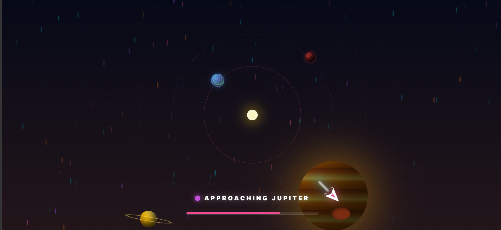
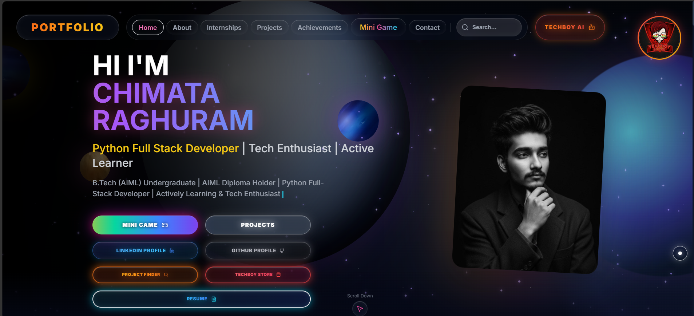
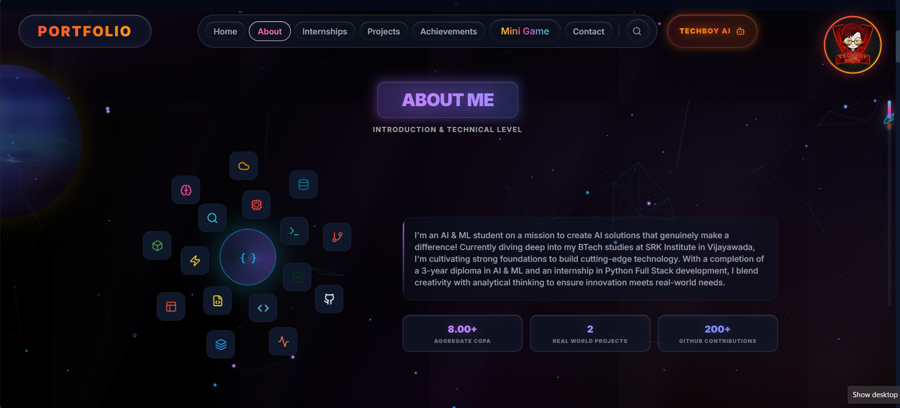
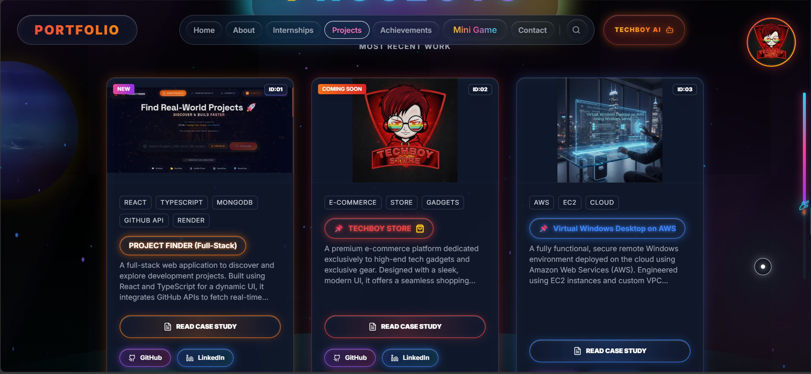
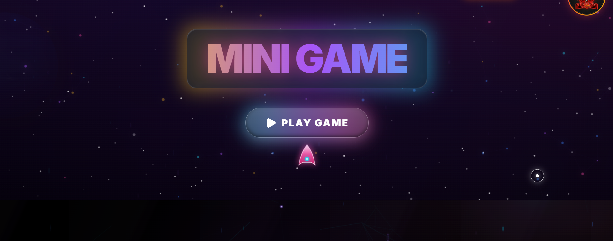
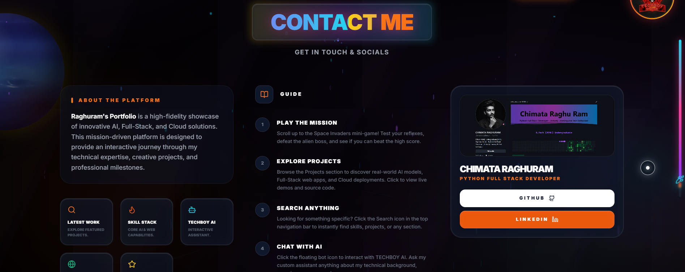
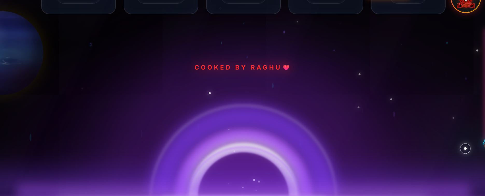
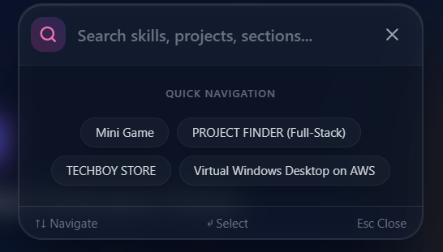
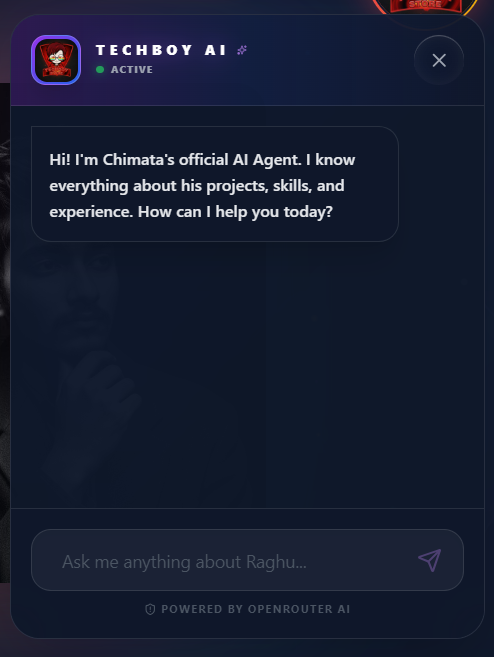
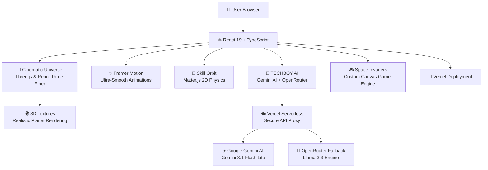

<div align="center">

  

  <h1>CHIMATA RAGHURAM</h1>
  
  <a href="https://chimataraghuram.vercel.app/">
    
  </a>

  <br/><br/>

  <!-- High-Status Tech Badges -->
  <p align="center">
    
    
    
    
    
  </p>

  <!-- Primary CTA Action Bar -->
  <p align="center" style="margin-top: 15px;">
    <a href="https://chimataraghuram.vercel.app/">
      
    </a>
    &nbsp;&nbsp;
    <a href="https://www.linkedin.com/in/chimataraghuram/">
      
    </a>
    &nbsp;&nbsp;
    <a href="https://leetcode.com/u/chimataraghuram/">
      
    </a>
  </p>

  <br/>

  <p align="center" style="max-width: 800px; margin: 0 auto; line-height: 1.6;">
    <em>"A cinematic, 3D space-themed digital ecosystem redefining the professional portfolio. Engineered for zero compromise, blending high-performance WebGL graphics, real-time physics, interactive storytelling, and an integrated AI assistant to deliver a premium experience."</em>
  </p>

</div>

---

## 🌌 The Cinematic Universe

This portfolio has been completely reimagined as an interactive voyage through space. The experience includes:

- **Immersive 3D Preloader**: Fly through a rotating solar system with hundreds of glowing stars before entering the portfolio universe.
- **Dynamic 3D Planetary Systems**: Using **React Three Fiber** and **Three.js**, the background features massive, high-resolution planets (Earth, Moon, Neptune, Mars) that realistically morph and rotate as you scroll.
- **Parallax Starfields & Nebula Fogs**: Deep, multi-layered parallax backgrounds that respond to your scroll and section transitions.
- **Glassmorphism 2.0**: The UI floats beautifully above the 3D canvas with heavy blur backdrops, creating an ultra-premium aesthetic.

---

## 🖼️ Project Showcase
*Visual walkthrough of the platform's high-fidelity design and interactive elements.*

<div align="center">

### **01. The Identity Hub**
*High-performance central dashboard for professional identity.*  


<br/>

### **02. About & Skill Orbit**
*Clean, glassmorphism-driven introduction with a physics-based tech stack visualization.*  


<br/>

### **03. Professional Internships**
*Career chronology showcase featuring industry experience and verifiable certificates.*  


<br/>

### **04. The Project Vault**
*Premium gallery showcasing high-fidelity real-world deployments and full-stack applications.*  


<br/>

### **05. Milestones & Achievements**
*Curated list of professional certifications and significant career milestones.*  


<br/>

### **06. Space Invaders Mini-Game**
*Custom 60FPS Canvas-based game engine built for in-browser interactive engagement.*  


<br/>

### **07. Contact & Social Terminal**
*Central point for direct communication and professional social network integration.*  


<br/>

### **08. Omni-Search Navigation**
*Global search terminal for instant access to skills, projects, and platform sections.*  


<br/>

### **09. Techboy AI Assistant**
*Integrated AI agent providing real-time insights into the developer's journey.*  


</div>

---

## 🏗️ System Architecture



---

## ⚡ Core Capabilities

> [!TIP]
> **Performance Optimized**: This ecosystem is built on Vite 6 and React 19, utilizing `Suspense` and dynamic imports to ensure lightning-fast load times even with heavy 3D assets.

- **🌍 WebGL 3D Engine**: Uses `Three.js` and `@react-three/fiber` to render massive 3D planets, atmospheric scattering, and 3000+ interactive stars at 60FPS.
- **🧠 Physics-Driven UI**: Uses `Matter.js` to create an interactive "Skill Orbit" that responds to gravity and collision physics.
- **🤖 Intelligence Layer**: Integrated **TECHBOY AI** assistant trained on Raghu's verified background, GitHub repos, and LinkedIn experience, powered by Google Gemini AI with high-speed bulleted responses.
- **🎮 Micro-Game Integration**: A custom 60FPS Space Invaders engine built natively on HTML5 Canvas featuring multi-wave arcade combat, synchronized formations, power-up systems, and an interactive Level 3 Boss battle.
- **✨ Fluid Motion**: `framer-motion` drives complex orchestrations, from the spaceship preloader sequence to scroll-triggered section reveals.

---

## 🛠 Tech Stack

### **The Core Engine**
- **Framework**: React 19
- **Build Tool**: Vite 6
- **Logic**: TypeScript
- **Styling**: TailwindCSS + Vanilla CSS + Glassmorphism Shaders

### **The Specialized Layer**
- **3D Graphics**: Three.js, React Three Fiber, React Three Drei
- **Animations**: Framer Motion
- **2D Physics**: Matter.js
- **Icons**: Lucide-React
- **AI**: Google Gemini AI (Gemini 3.1 Flash Lite / 3.5 Flash) + OpenRouter Fallback
- **Game Engine**: Custom HTML5 Canvas Arcade Engine with responsive HUD, power-ups, and Level 3 Boss mechanics

---

## 💼 Featured Engineering & Internships

### **1. Professional Experience**
- **AI Software Developer Intern** — *Jaimini Group* (Jul 2026 – Present) [Remote]
  - Owned end-to-end backend development for NQAS.ai, integrating six AI modules from architecture through deployment.
  - Backend/API testing, GitHub deployment management, and Jira task tracking.
- **Python Backend Intern** — *Infosys Springboard 7.0* (Jun 2026 – Sep 2026) [Remote]
  - Built OpenCV-based face and tab-switch monitoring with integrity scoring for ExamMonitor in an Agile team.
  - Unit tests, defect tracking, and Agile sprint documentation under mentor guidance.
- **Cloud Computing Intern** — *APSSDC* (May 2025 – Jul 2025) [Remote]
  - Hands-on AWS EC2 deployment with Nginx, Security Groups, IAM, and Lambda.
  - Built an end-to-end cloud automation mini-project showcasing cloud infrastructure workflows.

### **2. Core Applications**
- **PROJECT FINDER (Full-Stack)**: Multi-platform discovery engine across GitHub, HuggingFace, Kaggle & LinkedIn with Gemini AI architectural analysis and side-by-side Comparison Studio.
- **TECHBOY STORE**: Smartphone intelligence platform featuring real-time price tracking, automated n8n email alerts, and Google OAuth.
- **ExamMonitor (Infosys Springboard)**: Smart examination monitoring platform with OpenCV computer vision proctoring (face absence, multi-person detection, tab-switching) and automated integrity scoring.
- **AWS EC2 Web Deployment**: Production-grade static website deployment on Ubuntu Linux EC2 instance via SSH, Apache2, and custom Security Groups.

---

## 📁 Project Structure

```bash
PORTFOLIO/
├── frontend/
│   ├── src/
│   │   ├── components/
│   │   │   ├── universe/      # The 3D Three.js Engine & Cinematic backgrounds
│   │   │   ├── IntroScreen/   # The spaceship solar system preloader
│   │   │   └── ...            # Main UI modules (Hero, About, Projects, Internships, etc)
│   │   ├── hooks/             # Custom React hooks (useIsMobile, useActiveSection)
│   │   ├── utils/             # Helper functions (scrolling, sound engine)
│   │   ├── App.tsx            # Modular section aggregator & Lazy Loading
│   │   └── constants.ts       # Central Truth - All metadata (Projects, Skills, Stats)
│   ├── public/
│   │   ├── planets/           # High-resolution WebGL planet textures
│   │   └── project-screenshots/ # High-resolution project previews
│   └── vite.config.ts         # Optimized build settings
├── backend/
│   └── chat.js                # Core API/chat logic & LLM integrations
└── api/                       # Vercel Serverless entry point (AI Proxy wrapper)
```

---

## 📜 Professional Ethics (License)
This project is licensed under the **MIT License**.

> [!IMPORTANT]
> **Attribution Requirement**:
> You are encouraged to study and fork this repository. However, proper attribution to **Chimata Raghuram** is mandatory. Do not represent this holistic design as your own original creation.

---

## ✍️ The Author

<div align="center">

  <table style="border: none; background: transparent;">
    <tr style="border: none; background: transparent;">
      <td align="center" style="border: none; padding: 15px;">
        
        <br/><br/>
        <h3 style="margin: 0; padding: 0; color: #ffffff; font-weight: 800; letter-spacing: 1px;">CHIMATA RAGHURAM</h3>
        <p style="margin: 6px 0 16px 0; color: #ff8c42; font-weight: 600; font-size: 14px;">
          <em>Python Full Stack Developer &bull; AI/ML Engineer &bull; Tech Enthusiast</em>
        </p>
        <p align="center">
          <a href="https://github.com/chimataraghuram" target="_blank">
            
          </a>
          &nbsp;
          <a href="https://www.linkedin.com/in/chimataraghuram/" target="_blank">
            
          </a>
          &nbsp;
          <a href="https://leetcode.com/u/chimataraghuram/" target="_blank">
            
          </a>
          &nbsp;
          <a href="https://chimataraghuram.vercel.app/" target="_blank">
            
          </a>
        </p>
        <br/>
        
      </td>
    </tr>
  </table>

</div>
